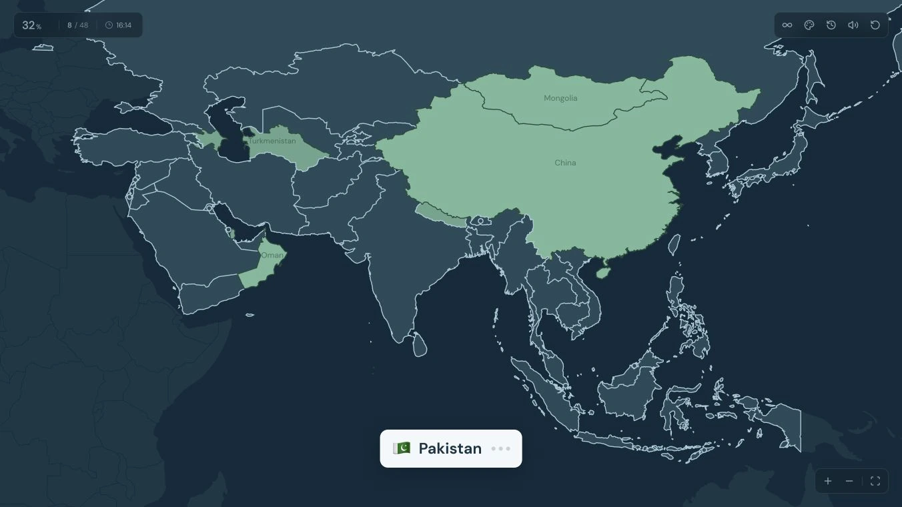

# Country map quiz

A fullscreen, browser-local Asia quiz with the same 48-country selection as [Seterra's Asia quiz](https://www.geoguessr.com/vgp/3167).

## Run

`npm install` then `npm run dev`. Open http://localhost:5197.

`npm run build` makes a static production build in `dist/`. `npm run preview` serves that build. No backend, credentials, or accounts are needed.

## Hosting

ChatGPT Sites hosts the static `dist/` build. `.openai/hosting.json` links this checkout to its Site. Publishing uses the Sites workflow to build, save the matching source revision, and deploy that revision. The Site starts private; its audience is managed separately in Sites.

Game data stays in the visitor's browser. Open tabs of the same site synchronize progress, history, and preferences; only the focused window advances the timer. Moving to a new hostname does not automatically copy history from localhost, and progress does not sync across devices. No hosted database or file-storage binding is required.

## Play

- Hover to highlight, click to answer. The high-contrast prompt shows the flag and country name. It follows the pointer; keyboard and touch input return it to the bottom. Each wrong guess turns one of its three dots red.
- Three incorrect guesses reveal the answer with a gold color pulse. The color cue continues at a slower pace with reduced motion enabled. Wrong clicks briefly flash the country red and identify it in a top-center message. Country focus follows the shape without a rectangular outline.
- Found countries use a contrasting green, with a nearby shade for assisted answers. Labels stay muted and fitted inside the country, appearing only when they fit at least 10 screen pixels and capped at 12 pixels. A fresh hover over a previously found country shows its flag and name at the top center; answering correctly never triggers that label. Unguessed countries stay unnamed.
- Accuracy is completed countries divided by total guesses. Water, completed countries, and countries outside the current practice set don't count as guesses.
- Practice focuses on target countries you missed at least once, including revealed answers. The main practice button uses all recorded mistakes; past attempts and completed quizzes offer practice for their own mistakes. Restarting after a wrong guess preserves that target for practice. Practice is unscored and can be repeated freely.
- The current round, missed countries, theme and mute preferences, and all completed or interrupted quizzes are stored in localStorage under `country-map-quiz.v1`. Version 2 profiles recover mistakes from older saved answers and preserve active quizzes; old known-country practice rounds restart with the missed-country set.
- Past attempts scroll inside the dialog. Delete an individual attempt or clear the history, with Undo for the last deletion. Deleting history keeps the current round and recorded practice mistakes.
- The palette button switches between Ocean, Forest, Dusk, and Paper; the chosen theme is saved locally. Country borders use brighter strokes on dark themes and darker strokes on Paper. The cursor prompt includes the target country flag.
- Scroll or pinch to zoom, drag to move, or use the bottom-right controls. The initial and reset view is zoomed to 150% and centered on the countries below Russia, leaving northern and eastern Russia partly offscreen. Country shapes also support Tab and Enter/Space.
- Small-country markers have expanded click areas. Where those areas overlap, the nearest marker wins for both hovering and clicking. Finding a small country removes its expanded target; its actual map shape remains available for hover lookup.
- Controls and score statistics have hover tooltips.
- Short synthesized right/wrong sounds are enabled by default. The speaker button mutes them. There is no speech.

## Sources and development

Geography is public-domain [Natural Earth data redistributed by world-atlas](https://github.com/topojson/world-atlas), projected ahead of time with D3. `npm run generate:map` regenerates `src/data/map.json` from the retained source package. Label positions and sizes are fitted to each country polygon at generation time. The browser does not load a mapping library or fetch map tiles. Selection follows the referenced game; the dataset provides the boundaries.

Cursor SVGs are copied unchanged from Harmony's landing-page `public/cursors` folder. Water uses the rounded arrow, countries use the pointing hand, and dragging uses the closed hand.

The shared `@noah/segtest` package is included as a committed vendor archive. Vite provides its development-only `/api/debug/segtest` route and the app has a `next-themes` provider. No comparison is active. Follow `/Users/noahjackson/segtest/src/DebugSegtestPanel.tsx` when adding one.
